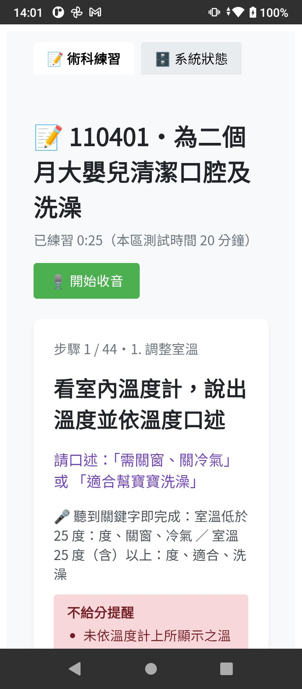
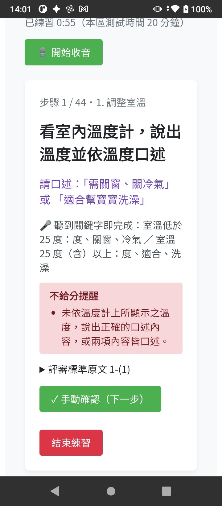
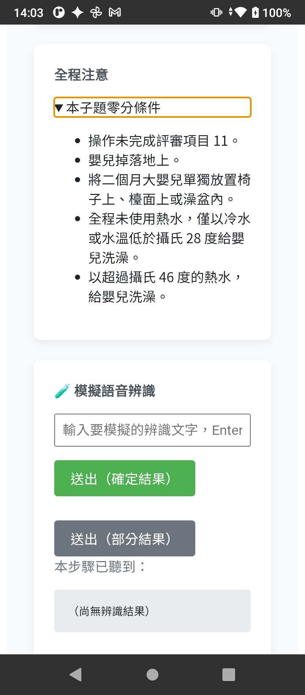

# CarePass 托育術術過

托育人員（保母）技術士術科的練習 App。考生雙手實作時，App 用離線語音辨識聆聽口述的關鍵字，自動提示下一個步驟，練習時不用碰手機。

- 題庫依據：技術士技能檢定托育人員單一級術科測試應檢人參考資料（114-10-03 修訂）
- 支援平台：Android（主要目標）、桌面版 Electron（macOS / Windows / Linux）

## 畫面

<table>
  <tr>
    <td align="center"></td>
    <td align="center"></td>
    <td align="center"></td>
  </tr>
  <tr>
    <td align="center">練習步驟：口述提示與觸發關鍵字</td>
    <td align="center">不給分提醒、語音沒聽到時手動確認</td>
    <td align="center">從官方題庫結構化的零分條件</td>
  </tr>
</table>

## 功能

- **語音自動推進步驟**：考生雙手實作、口述關鍵字，App 聽到後自動跳到下一步，不用碰手機。辨識器還在送「部分結果」時，只要比對到就推進，不必等停頓。
- **完全離線辨識**：語音模型（約 21MB）內建在 App 裡，不用連網，也不會上傳錄音。
- **能容忍辨識錯字的比對**：
  - 兩個字以上的關鍵字改比拼音，同音字也算（例如「異物」被辨識成「義務」）
  - 阿拉伯數字自動加上口語唸法（37 → 三十七、119 → 一一九），也能辨識口述的日期、數字
  - 模型輸出簡體，先轉繁體再比對
- **依考題設計多種觸發規則**：關鍵字全部或任一命中、數數、限時內說話（例如「與嬰兒說話互動」）、累計口述字數、「語音沒聽到就手動確認」，以及操作過程中的次數要求（例如「至少 2 次給予鼓勵」）。
- **結構化題庫**：把官方術科參考資料（PDF）拆成 8 個題號的 JSON，包含配分、評審標準、不給分說明和語音觸發規則，另附欄位定義和驗證腳本。
- **計時與 CPR 練習**：子題倒數計時；CPR 檢查循環數和總秒數，並用節拍器輔助按壓速率。
- **練習摘要**：結束後統計完成的步驟數、語音和手動完成的比例、次數要求是否達標，以及提醒事項。
- **跨平台**：Android 和桌面版共用同一套 React 介面和提示引擎。

## 技術

- **語言 / 框架**：JavaScript、React 18、Vite 5；桌面殼用 Electron 30，行動殼用 Capacitor 8（Android），語音辨識的原生插件用 Java 撰寫
- **語音辨識**：sherpa-onnx 1.13.8（中文串流 Zipformer CTC int8 小模型）
  - 桌面：AudioWorklet 擷取 16kHz 音訊 → IPC → 主進程以 `worker_threads` 執行 `sherpa-onnx-node`
  - Android：`AudioRecord` → 自製 Capacitor 插件 `SherpaAsrPlugin`（sherpa-onnx AAR）→ `notifyListeners` 回傳給前端
- **文字比對**：pinyin-pro（拼音比對）、opencc-js（簡繁轉換）；提示引擎是純函式 reducer，不依賴任何平台
- **架構**：平台適配層（electron / capacitor / web 三份實作），UI 只呼叫這一層
- **資料庫**：SQLite（桌面 knex + better-sqlite3；Android @capacitor-community/sqlite），兩邊共用 migration SQL
- **測試**：Node 內建 test runner（`node --test`）測提示引擎和比對規則；題庫 JSON 驗證腳本；WAV 音檔辨識測試；App 內建語音辨識效能測試（RTF）
- **開發環境 / CI**：開發和建置全部在 Docker 容器裡（網頁遠端桌面、Node 22、JDK 21、Android SDK 36）；GitHub Actions 推送標籤時打包 macOS dmg

### 語音辨識流程

```
桌面：   麥克風 → AudioWorklet（16kHz）→ IPC → worker_threads（sherpa-onnx）→ IPC
Android：麥克風 → AudioRecord（16kHz）→ SherpaAsrPlugin（sherpa-onnx）→ notifyListeners
         → 簡體轉繁體 → 提示引擎比對關鍵字 → 自動跳下一步
```

## 開發中遇到的問題與解法

- **官方題庫是 PDF，規則寫在文字裡，程式沒辦法直接用**
  → 定義 JSON schema，逐題拆成「子題 → 項目 → 評審標準」，每一步都有語音觸發規則。「不給分說明」改成放在原文指定的對象上，不往上層合併；408 和 407 相同的子題用 `sameAs` 引用，不重複寫。另寫驗證腳本檢查配分加總、編號和觸發規則格式。

- **辨識結果常出現同音錯字，字面比對常常失敗**
  → 改比拼音（不比聲調）。但單一個字的同音字太多（「十」和「是」），所以只有兩個字以上的關鍵字才用拼音比對。

- **模型輸出簡體字，數字也是中文**
  → 比對前先做簡繁轉換和正規化（去掉標點、全形轉半形），關鍵字裡的阿拉伯數字自動產生口語唸法。

- **桌面版在 Electron 裡出現「External buffers are not allowed」，用 Node 測試卻正常**
  → Electron 21 之後開啟了 V8 memory cage，不允許原生模組把自己配置的記憶體直接交給 JavaScript。呼叫 sherpa-onnx 的 `readWave` 時把 `enableExternalBuffer` 設為 `false`，改成複製一份記憶體。這個問題只在 Electron 執行環境才會出現，所以單元測試抓不到。

- **打包後原生模組讀不到模型檔**
  → 原生程式無法讀取 asar 封包裡的檔案。模型改用 `extraResources` 放到安裝目錄，語音辨識模組和 sherpa-onnx 用 `asarUnpack` 解出來。

- **開發機（舊款雙核心 Intel）上的容器跑不到即時辨識（RTF ≈ 3.1）**
  → 桌面版只用來驗證流程，即時測試移到 Android 實機。手機實測 RTF ≈ 0.27、模型載入 8.9 秒，可以即時辨識並自動推進。也因為效能考量，先用 21MB 小模型搭配寬鬆的拼音比對，暫時不換 133MB 的大模型。

- **容器裡沒有麥克風，沒辦法測語音流程**
  → 做了「模擬語音辨識」面板，可以輸入文字模擬部分結果和確定結果；另外用 WAV 檔測試腳本，以及開啟遠端桌面（Selkies）的麥克風轉送。

- **模擬面板輸入中文時漏字（例如「牙縫」變成「縫」，再打一次變成「縫牙縫」）**
  → 練習頁每 0.5 秒重繪一次，打斷了輸入法組字；用 Enter 選字時也會被當成送出。輸入框改成不受 React 控制（用 ref 讀寫），並且只在 `isComposing` 為 false 時才把 Enter 當成送出。

- **Docker 在 Mac 上的掛載很慢，第一次 Gradle 建置要好幾個小時，重建容器快取就沒了**
  → Gradle 快取改用 Docker named volume，不受容器重建影響，也避開了掛載資料夾的 I/O 瓶頸。

- **小模型會漏字，停頓約 1.2 秒才送出確定結果**（尚未解決）
  → 引擎在部分結果比對到就推進，所以不受停頓影響。漏字的部分，下一步打算評估縮短斷句時間（EndpointRule）、調整關鍵字，或換成支援熱詞的 transducer 模型。

## 目前狀態

- Android 版已在實機上驗證即時辨識與自動推進。
- 尚未完成：練習紀錄存檔、iOS 版與瀏覽器版語音辨識、Windows 安裝檔帶入語音辨識模組。
