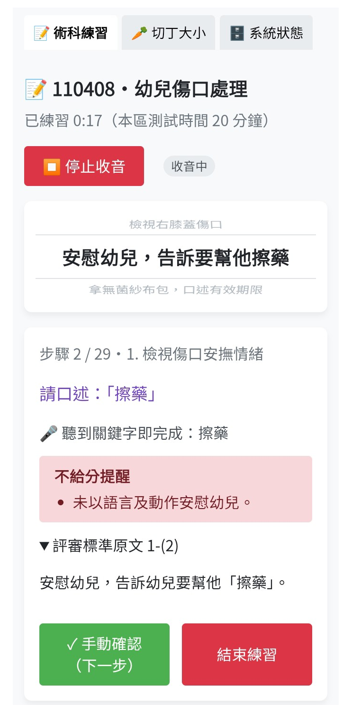
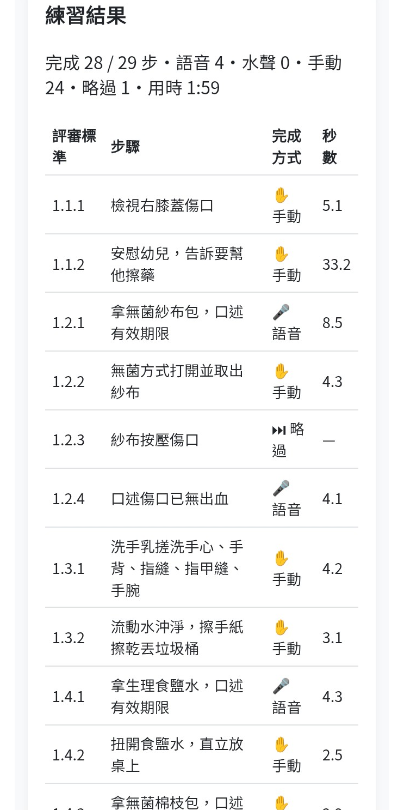
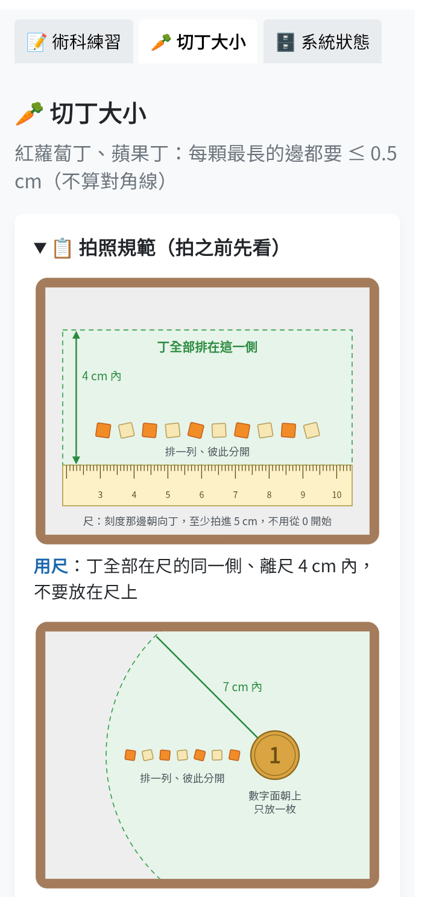
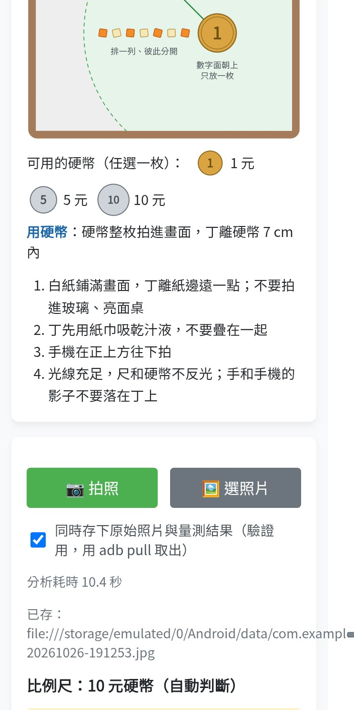
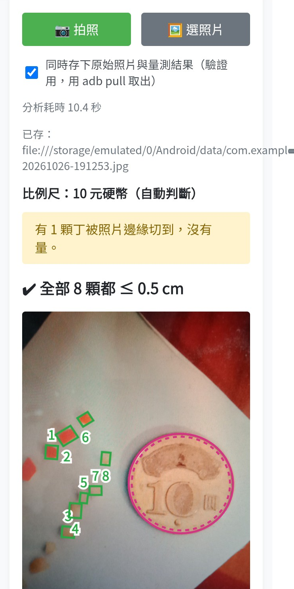
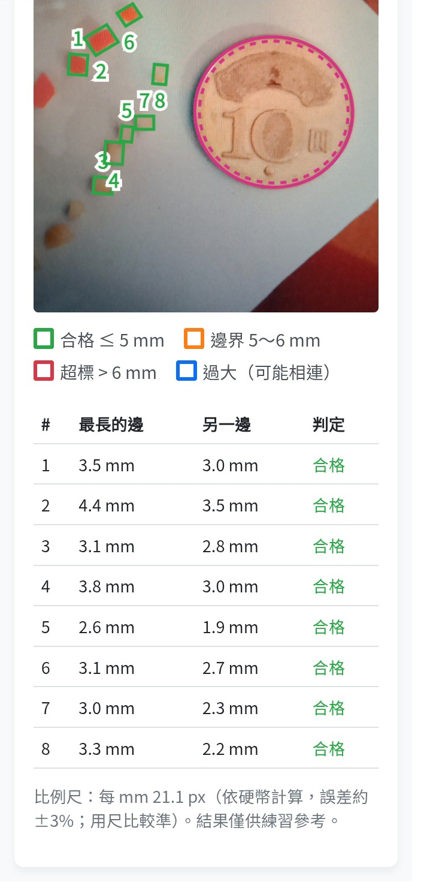

#  CarePass 托育術術過

托育人員（保母）技術士術科的練習 App。考生雙手實作時，App 用離線語音辨識聆聽口述的關鍵字，洗手步驟則聽水龍頭的開關，自動提示下一個步驟，練習時不用碰手機。另外可以拍照量測切丁大小，檢查每顆丁是否在 0.5 cm 以內。

- 題庫依據：技術士技能檢定托育人員單一級術科測試應檢人參考資料（114-10-03 修訂）
- 支援平台：Android（主要目標）、桌面版 Electron（macOS / Windows / Linux）

## 畫面

<table>
  <tr>
    <td align="center"></td>
    <td align="center"></td>
    <td align="center"></td>
  </tr>
  <tr>
    <td align="center">練習步驟：步驟轉輪、口述與關鍵字、不給分提醒</td>
    <td align="center">練習結果：每一步的完成方式（語音、手動、略過）與秒數</td>
    <td align="center">切丁大小：拍照規範（用尺、用硬幣的俯視示意圖）</td>
  </tr>
  <tr>
    <td align="center"></td>
    <td align="center"></td>
    <td align="center"></td>
  </tr>
  <tr>
    <td align="center">拍照後自動判斷比例尺（這張是 10 元硬幣）</td>
    <td align="center">標註圖：每顆丁的編號與框線</td>
    <td align="center">量測結果：最長的邊、另一邊、判定</td>
  </tr>
</table>

## 功能

- **語音自動推進步驟**：考生雙手實作、口述關鍵字，App 聽到後自動跳到下一步，不用碰手機。辨識器還在送「部分結果」時，只要比對到就推進，不必等停頓。
- **往後比對**：目前步驟沒聽到關鍵字時（辨識漏字，或做完手動步驟忘了按確認），也比對之後 10 步；說到後面步驟的台詞就直接完成那一步，中間的步驟記為略過。只算字數、數數的步驟不參與，避免隨口一句話就跳步；系統狀態頁可以關閉或調整步數。
- **洗手步驟聽水聲自動推進**：偵測水龍頭開關（開水沖濕 → 關水搓洗 → 開水沖洗 → 關水），第 2 次關水自動進入下一步；手機放在約 1 公尺外、邊開水邊說話也能判斷，開水、關水約 1～2 秒就反應。
- **現場環境音校正**：App 啟動時（同時載入語音模型）先錄一次安靜的聲音當作基準，練習開始收音時再於背景重錄（聽到有人說話就重錄，最多 3 次），不寫死音量門檻，換手機、換位置都適用；靈敏度可調整。
- **步驟音效**：每推進一步就播放提示音，自動推進是輕柔的翻頁聲，手動確認是輕觸加翻頁聲；用 Web Audio 即時合成，不需要音效檔。考生不用一直看畫面。
- **完全離線辨識**：語音模型（約 21MB）內建在 App 裡，不用連網，也不會上傳錄音。
- **能容忍辨識錯字的比對**：
  - 兩個字以上的關鍵字改比拼音，同音字也算（例如「異物」被辨識成「義務」）
  - 常被辨識錯的詞可以設定別名（例如「冷水」被辨識成「人水」）
  - 阿拉伯數字自動加上口語唸法（37 → 三十七、119 → 一一九），也能辨識口述的日期、數字
  - 模型輸出簡體，先轉繁體再比對
  - 台詞較長、辨識常漏掉其中一個關鍵字的步驟，聽到任一個關鍵字就算
- **依考題設計多種觸發規則**：關鍵字全部或任一命中、數數、限時內說話（例如「與嬰兒說話互動」）、累計口述字數、「語音沒聽到就手動確認」，以及操作過程中的次數要求（例如「至少 2 次給予鼓勵」）。
- **步驟轉輪**：卡片上方顯示上一步／目前／下一步；手指拖動可以瀏覽各步驟的結果，放開才跳步。往後跳時，中間的步驟記為略過；往前跳可以重做。手機直立時縮小版面，主提示詞放不下時用跑馬燈捲動。
- **切丁大小拍照量測**：拍一張或選一張照片，量每顆丁最長的邊是否 ≤ 0.5 cm（≤ 5 mm 合格、5～6 mm 邊界、超過 6 mm 超標），並在照片上標出每顆丁的編號和框線。
  - 自動判斷比例尺：照片裡放一把尺（什麼顏色、透明的都可以），或一枚 1、5、10 元硬幣，不需要特製圖卡
  - 斜拍處理：尺分段量刻度，修正透視；左右差太多時請使用者重拍。硬幣斜拍成橢圓時，拉回正圓再量
  - 抓得到只比白紙黃一點的新鮮蘋果丁；相連的丁沿著細縫切開；被照片邊緣切到的丁不量
  - 拍照規範用俯視示意圖說明（用尺、用硬幣各一張）
  - 全部在手機上離線計算，不上傳照片
- **結構化題庫**：把官方術科參考資料（PDF）拆成 8 個題號的 JSON，包含配分、評審標準、不給分說明和語音觸發規則，另附欄位定義和驗證腳本。
- **計時與 CPR 練習**：子題倒數計時；CPR 檢查循環數和總秒數，並用節拍器輔助按壓速率。
- **練習摘要**：結束後統計完成的步驟數、語音／水聲／手動完成的比例、次數要求是否達標，以及提醒事項。
- **跨平台**：Android 和桌面版共用同一套 React 介面和提示引擎。

## 技術

- **語言 / 框架**：JavaScript、React 18、Vite 8；桌面殼用 Electron 44，行動殼用 Capacitor 8（Android），語音辨識的原生插件用 Java 撰寫
- **語音辨識**：sherpa-onnx 1.13.8（中文串流 Zipformer CTC int8 小模型）
  - 桌面：AudioWorklet 擷取 16kHz 音訊 → IPC → 主進程以 `worker_threads` 執行 `sherpa-onnx-node`
  - Android：`AudioRecord` → 自製 Capacitor 插件 `SherpaAsrPlugin`（sherpa-onnx AAR）→ `notifyListeners` 回傳給前端
- **水聲偵測**：Android 原生端把麥克風音訊經過 4kHz 高通濾波（兩級 Butterworth biquad），每 0.5 秒回報最近 2 秒高頻音量的中位數與起伏；前端依現場校正的安靜基準判斷開水、關水
- **音效**：Web Audio 即時合成（粉紅噪音＋掃頻帶通濾波模擬翻頁聲）
- **文字比對**：pinyin-pro（拼音比對）、opencc-js（簡繁轉換）；提示引擎是純函式 reducer，不依賴任何平台
  - 水聲判斷規則和環境音校正流程也寫成純函式，React hook 只負責把收音事件轉交過去
- **影像量測**：純 JavaScript，在 Web Worker 執行（不用 OpenCV），照片縮到長邊 1600 px
  - 尺：用 FFT 求灰階 1 mm 刻度的週期；硬幣：Hough 找圓 → RANSAC 擬合橢圓 → 依外環紋路判斷幣值
  - 相連的丁用簡化版 watershed 切開
- **型別提示**：專案沒有 TypeScript 工具鏈，匯出函式和 React 元件用 JSDoc 標註，再用 tsc 的 strictNullChecks 檢查
- **架構**：平台適配層（electron / capacitor / web 三份實作），UI 只呼叫這一層
- **資料庫**：SQLite（桌面 knex + better-sqlite3；Android @capacitor-community/sqlite），兩邊共用 migration SQL
- **錯誤報告**：GlitchTip（相容 Sentry SDK，免費方案），只有 Android；不送使用者身分、不錄畫面、不追蹤效能，console 紀錄一律不送（可能含辨識文字）；系統狀態頁可以關閉
- **測試**：Node 內建 test runner（`node --test`）測提示引擎、比對規則、水聲判斷規則與環境音校正流程（共 56 項）；切丁大小的合成照片測試，以及實拍照片回歸測試（已知問題標成 todo）；實量對照腳本；題庫 JSON 驗證腳本；WAV 音檔辨識測試；App 內建語音辨識效能測試（RTF）與環境音監測面板（可同時錄 WAV 和紀錄檔，供離線分析）
- **開發環境 / CI**：開發和建置全部在 Docker 容器裡（網頁遠端桌面、Node 22、JDK 21、Android SDK 36），npm 套件在映像檔建置時安裝，新電腦 clone 後一個指令就能啟動；容器內可打包 Linux（AppImage、deb）、Windows（Wine 交叉打包，含語音辨識）與 Android；GitHub Actions 推送標籤時打包 macOS dmg
- **商店素材**：Python（Pillow）腳本從 logo 產生 Play 圖示與 Android 各密度的桌面圖示（adaptive icon）

### 語音辨識流程

```
桌面：   麥克風 → AudioWorklet（16kHz）→ IPC → worker_threads（sherpa-onnx）→ IPC
Android：麥克風 → AudioRecord（16kHz）→ SherpaAsrPlugin（sherpa-onnx）→ notifyListeners
         → 簡體轉繁體 → 提示引擎比對關鍵字 → 自動跳下一步
```

## 開發中遇到的問題與解法

- **官方題庫是 PDF，規則寫在文字裡，程式沒辦法直接用**
  → 定義 JSON schema，逐題拆成「子題 → 項目 → 評審標準」，每一步都有語音觸發規則。「不給分說明」改成放在原文指定的對象上，不往上層合併；408 和 407 相同的子題用 `sameAs` 引用，不重複寫。另寫驗證腳本檢查配分加總、編號和觸發規則格式。

- **辨識結果常出現同音錯字，字面比對常常失敗**
  → 改比拼音（不比聲調）。但單一個字的同音字太多（「十」和「是」），所以只有兩個字以上的關鍵字才用拼音比對。

- **模型輸出簡體字，數字也是中文**
  → 比對前先做簡繁轉換和正規化（去掉標點、全形轉半形），關鍵字裡的阿拉伯數字自動產生口語唸法。

- **桌面版在 Electron 裡出現「External buffers are not allowed」，用 Node 測試卻正常**
  → Electron 21 之後開啟了 V8 memory cage，不允許原生模組把自己配置的記憶體直接交給 JavaScript。呼叫 sherpa-onnx 的 `readWave` 時把 `enableExternalBuffer` 設為 `false`，改成複製一份記憶體。這個問題只在 Electron 執行環境才會出現，所以單元測試抓不到。

- **打包後原生模組讀不到模型檔**
  → 原生程式無法讀取 asar 封包裡的檔案。模型改用 `extraResources` 放到安裝目錄，語音辨識模組和 sherpa-onnx 用 `asarUnpack` 解出來。

- **開發機（舊款雙核心 Intel）上的容器跑不到即時辨識（RTF ≈ 3.1）**
  → 桌面版只用來驗證流程，即時測試移到 Android 實機。手機實測 RTF ≈ 0.27、模型載入 8.9 秒，可以即時辨識並自動推進。也因為效能考量，先用 21MB 小模型搭配寬鬆的拼音比對，暫時不換 133MB 的大模型。

- **容器裡沒有麥克風，沒辦法測語音流程**
  → 做了「模擬語音辨識」面板，可以輸入文字模擬部分結果和確定結果；另外用 WAV 檔測試腳本，以及開啟遠端桌面（Selkies）的麥克風轉送。

- **模擬面板輸入中文時漏字（例如「牙縫」變成「縫」，再打一次變成「縫牙縫」）**
  → 練習頁每 0.5 秒重繪一次，打斷了輸入法組字；用 Enter 選字時也會被當成送出。輸入框改成不受 React 控制（用 ref 讀寫），並且只在 `isComposing` 為 false 時才把 Enter 當成送出。

- **Docker 在 Mac 上的掛載很慢，第一次 Gradle 建置要好幾個小時，重建容器快取就沒了**
  → Gradle 快取改用 Docker named volume，不受容器重建影響，也避開了掛載資料夾的 I/O 瓶頸。

- **想用環境音分類模型（CED，AudioSet 527 類）偵測水聲，手機一離開水槽就聽不到**
  → 手機放在水槽邊時可以分辨，但距離 1 公尺時，模型把水聲判斷成蟲叫（Insect、Cricket），換大一級的模型也一樣。存下 WAV 離線分析後發現，水聲其實錄得很清楚：4kHz 以上的高頻音量比安靜時高 30 dB 以上，只是模型認不出來。改用「高頻音量」判斷，不需要模型，運算量幾乎是零，也省下 6MB 的模型檔。

- **邊開水邊說話時，判斷不穩定**
  → 說話的高頻（ㄙ、ㄕ 這類氣音）是一陣一陣的，水聲則是持續的。改看最近 2 秒的中位數，並要求起伏夠小，才算開水。用 9 段實測錄音（安靜、電扇、說話、開水、邊開水邊說話）模擬，都沒有誤判。

- **不同手機、不同位置的音量差很多，門檻不能寫死**
  → 開始收音時在背景錄 3 秒安靜當作基準，門檻定為「比基準大聲多少 dB」。錄安靜時如果語音辨識聽到有人說話，就隔 3 秒、5 秒重錄，最多 3 次。開水之後再依實際的水聲音量，自動調整關水的門檻。

- **從開水到判斷為開水要 2 秒多**
  → 剛開水時，2 秒的視窗裡一半是安靜、一半是水聲，起伏很大，要等起伏降下來才會判斷為開水。改成「音量已經遠高於門檻時，不等起伏」，延遲縮短到約 1 秒，實測錄音也沒有增加誤判。

- **別名加上拼音比對後，產生意料外的配對**
  → 「指縫」設成「手指縫」的別名後，「腳趾縫」也被當成說了「手指縫」，因為「趾縫」和「指縫」同音。測試抓到這個問題後，改成用「指縫」、「清潔」當關鍵字，並刪掉這個別名。

- **校正流程寫在 React hook 裡，沒辦法測試**
  → 開始收音、停止收音、背景重試、洗手步驟校正，這幾種情況交錯時很容易出錯。把流程抽成純函式 reducer，hook 只負責轉交事件，再用 13 項測試涵蓋討論過的情境。

- **小模型會漏字，換模型或加熱詞有用嗎？**
  → 用 403 子題 1 的實際練習錄影，比較 10 個語音步驟各模型能比對成功幾步：
  - 目前的 CTC 小模型：3 步
  - transducer 模型加熱詞：最多 4 步，但慢 4 倍以上，推估手機跟不上即時辨識
  - 關鍵字偵測（KWS）：18 個關鍵字只抓到 6 個

  失敗多半是整個音節聽錯或被吃掉，換模型幫助有限。所以改成放寬比對條件：台詞較長的步驟聽到任一個關鍵字就算，常聽錯的詞加別名（例如「熄火」被聽成「洗紅」）。同一段錄音從 3 步提高到 7 步。

- **量切丁大小需要比例尺，但不想要求考生準備特製圖卡**
  → 改用尺的 1 mm 刻度：用 FFT 求灰階的週期，不看尺的顏色。黃褐色、透明粉紅、印滿圖案的尺實測都可以。尺分 6 段各自量，修正透視造成的遠近差。

- **身邊不一定有尺**
  → 用硬幣當比例尺（1 元 20 mm、5 元 22 mm、10 元 26 mm）。斜拍時硬幣會變成橢圓：長軸當直徑，沿短軸拉長回正圓，順便導正前後方向的傾斜。跟尺比：平均差 +0.2%、標準差 2.9%。

- **使用者忘了切換比例尺選項（選「尺」卻拍硬幣），結果全錯**
  → 拿掉選項，改成自動判斷：先找尺，沒有尺再找硬幣。1 元看外環格紋（每圈約 32 次），5、10 元看紋路的徑向分布。106 張照片驗證，105 張判斷正確。

- **新鮮蘋果丁幾乎抓不到**
  → 新鮮蘋果只比白紙黃一點，用固定門檻分不出來。改成跟附近 15 mm 內的紙比、每塊各自定門檻；同時允許丁自己的影子，用邊緣銳利度排除汁液漬。

- **透明三角尺放在白紙上，看不出丁在尺的哪一側**
  → 尺邊兩側的亮度差不到 1.5 倍時，改看哪一側的丁比較多（一張照片從 2 顆變 14 顆）。

- **手機量一張要 10～14 秒**
  → 照片從 2400 px 縮到 1600 px，角度改用半解析度灰階，刻度 FFT 每 4 列取 1 列，降到 4～7 秒（之後加進新鮮蘋果丁的處理，約 6～9 秒）。

- **程式量得準不準？**（部分尚未解決）
  → 拍照後用文書尺實量對照（游標卡尺會把軟的丁壓變形，不實際），兩批共 25 張：平均差 +0.06～+0.43 mm。2～3 mm 的小丁偏大約 1 mm，原因還在釐清。

- **新電腦要另外 npm install，主機和容器的套件可能不一致**
  → 改在映像檔建置時 `npm ci`，用匿名 volume 遮住主機的 node_modules 資料夾。

- **目前步驟沒聽到就卡住，後面說對了也不會推進**
  → 改成同時比對之後 10 步，取最近一個比對到的步驟。但「只算字數」的步驟說什麼都會成立，「數數」容易一路跳過整段 CPR，「口述日期、數字」隨口一個數字就會對到，這三種都不參與往後比對。

- **建立容器要 200 多秒，Windows 打包常常失敗**
  → 容器的家目錄（/config）改用不從映像檔複製的匿名 volume，建立時間縮短到約 1 分 40 秒，也順便修正了家目錄的權限問題。Windows 打包先建好 wine 資料夾，再等 wine 初始化完成，避免 electron-builder 只等 2 分鐘就放棄。

- **上架素材的規格跟手邊的檔案對不上**
  → logo 是白底圓角、不是正方形；手機截圖是 2.28:1，超過 Play 的 2:1 上限。圖示用腳本裁掉外框、補成方形，再產生各密度的桌面圖示；截圖裁掉狀態列與導覽列，左右補邊到 2:1。

- **錯誤報告送不出去**
  → @sentry/capacitor 和 @sentry/react 的核心版本不同時，畫面出錯會交給沒有初始化的那一份，錯誤就送不出去，所以兩個套件鎖定成同一個核心版本。另外 GlitchTip 不支援 Sentry 的 sessions，要把 SDK 的 session 追蹤關掉。

- **建置工具（Electron 30、electron-builder 24、Vite 5）有已知漏洞**
  → 一次升級到 Electron 44、electron-builder 26、Vite 8，npm audit 從 15 個降到 3 個。剩下的 3 個來自 Capacitor CLI 間接用到的 uuid，只有 iOS 會用到，而且呼叫的函式碰不到漏洞。better-sqlite3 升到 13 之後改用 N-API，套件內附各平台的預編譯檔，不用再針對 Electron 重新編譯；原本在 Linux 上替 Windows 編譯原生模組會失敗，也一起解決了。Vite 8 改用 Rolldown 打包，前端建置從 3～4 分鐘縮短到 1 分鐘以內。

- **Windows 安裝檔裡沒有語音辨識模組**
  → npm 只安裝跟目前系統相符的平台套件，在 Linux 容器裡打包 Windows 版時，只有 Linux 版的 sherpa-onnx。改用 `npm pack` 另外取得 Windows 版放進 node_modules，打包時各平台排除另一個平台的套件。中間踩到一個雷：平台設定的 `files` 只寫排除規則時，electron-builder 會自動補上「全部檔案」，把整個專案（3.4 GB）打包進去，加一行一定會打包的檔案就解決了。

- **容器裡下載 Windows 版 Electron（150 MB）一直逾時**
  → electron-builder 自己下載時，單次連線超過 10 分鐘就中斷，而且不能續傳；容器裡只有每秒 50～75 KB。改用 curl 下載（可以續傳、比對 SHA-256），放在重建容器也會保留的資料夾，打包時指定使用這個檔案。

- **升級後打包在 Mac 掛進容器的資料夾裡失敗（Unable to update lock）**
  → 新版 electron-builder 解壓 Electron 時會加檔案鎖，用檔案的修改時間判斷鎖是否還有效，在 Mac 掛進容器的資料夾裡會被判定失效。改成先輸出到容器內的 /tmp，再把安裝檔複製回專案資料夾。

## 目前狀態

- Android 版已在實機上驗證即時辨識、自動推進與步驟轉輪。
- 往後比對已在實機上驗證（110408 幼兒傷口處理）。
- 已驗證水聲判斷；洗手步驟的自動推進和步驟音效，待實機確認。
- 切丁大小：手機實測可以用（一張約 6～9 秒）。
  - 待確認：自動判斷比例尺在手機上的耗時、「選照片」（通訊軟體壓縮過的照片、HEIC 格式）、桌面版
  - 已知問題：塑膠袋皺褶被當成尺、整條邊貼在一起的丁切不開、小丁偏大約 1 mm
- 準備上架 Google Play：版本 1.0.7、套件名稱 io.github.kkker.carepass，圖示、主視覺圖、截圖已備齊；接下來是 release 簽署產出 AAB，以及封閉測試（12 位測試者、連續 14 天）。
- 錯誤報告（Android）：實機確認 GlitchTip 收得到錯誤與操作紀錄；測試期間預設開啟，正式上架前改成預設關閉。
- 規劃中：廣告（橫幅廣告、查看練習總報告前播放短影片廣告）與使用行為分析；加入時會一併更新隱私權政策與 Google Play 的資料安全性申報。
- 桌面版：Windows 安裝檔已帶入語音辨識，Windows 筆電實測可以使用（辨識、收音與自動推進）。
- 尚未完成：設定存進 SQLite 與設定頁、練習紀錄存檔、正式版隱藏開發用功能、iOS 版與瀏覽器版語音辨識。
